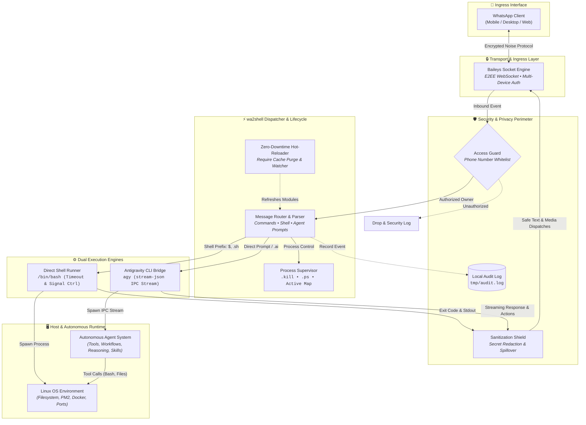

# wa2shell ⚡

> **Secure WhatsApp-to-Shell Gateway & Autonomous Antigravity Agent Controller.**  
> Execute bash commands, monitor infrastructure, debug server environments, and converse with headless Antigravity AI agents directly over end-to-end encrypted WhatsApp chats.

[](https://nodejs.org/)
[](package.json)
[](https://github.com/WhiskeySockets/Baileys)
[](README.md#privacy-data-retention--telemetry)
[](LICENSE)

---

## Overview

**wa2shell** bridges your WhatsApp messaging client directly to your Linux VPS terminal and autonomous **Antigravity CLI (`agy`)** agents.

Engineered for sysadmins, DevOps engineers, and self-hosters, `wa2shell` eliminates the need to expose open SSH ports to the public internet or maintain clunky mobile terminal apps. From any authorized WhatsApp chat, you can execute privileged POSIX shell commands, inspect system health, trigger CI/CD pipelines, kill hung tasks, and command autonomous AI agents that can read, edit, and troubleshoot your codebase in real time.

---

## What's New in v1.6.0

- 🎬 **Remotion Video Creation Skill & Tools (`skills/remotion-video/` & `tools/remotion/`)**:
  - **Built-in Skill Discovery Engine (`lib/skills.js`)**: Automatically discovers Markdown skills in `skills/*/SKILL.md` and injects relevant skill instructions into Antigravity Agent prompts when video/motion-graphic requests are detected.
  - **9:16 Portrait Motion Graphics Studio (`tools/remotion/templates/`)**: Pre-configured VPS-optimized Remotion studio (`1080x1920`, `30fps`, `rspack`, `x264 ultrafast`, `angle` OpenGL) with a 3-layer anti-slop `KineticShort` template (ambient glow, SVG cyber grid, animated circuit paths, kinetic typography, and per-scene audio).
  - **Double-Boosted Edge-TTS & FFmpeg Pipeline (`lib/remotion.js` & `tools/remotion/cli.js`)**: Generates loud, crisp Indonesian/multilingual narration (`--volume=+50%` + FFmpeg `volume=2.2,alimiter=limit=0.98`), measures exact duration via `ffprobe`, and renders `.mp4` videos ready for `[[SEND_VIDEO:...]]` WhatsApp delivery.
  - **New WhatsApp Commands**: `.video <topik>`, `.remotion [check|setup]`, and `.skills`.

---

## What's New in v1.5.0

- ⚡ **Live Agent Telemetry & Transparent Activity Engine (Anti-Stuck)**: Completely eliminates user uncertainty and silent wait states during multi-turn reasoning and tool runs.
  - **Dynamic In-Place Status Card**: Replaces confusing silence with a living status card quoted to the user message that smoothly edits in real-time (`edit: msgKey`), displaying the active model, current step count, tool name, and running seconds counter.
  - **Continuous Typing Presence Heartbeat**: Keeps WhatsApp's "typing..." (`composing`) state actively engaged throughout lengthy background operations, guaranteeing users know the bot is alive and processing.
  - **Tool & Command Action Previews**: Live visual feedback for tool invocations (`⚙️ run_command: git status`, `📝 read_file: config.js`, `🔍 search_web: ...`), showing exactly what POSIX command or file is being accessed.
  - **Transparent Execution Footers**: Every AI response now features an optional lightweight execution telemetry badge summarizing duration, model, and step count (`⚡ wa2shell v1.5.0 • 4.2s • gemini-3.8-flash-low • 3 langkah`).
- 📊 **Step Execution Audit & Transparency Inspector (`.steps` & `--steps`)**:
  - Run `.steps` / `.step` at any time to inspect a structured breakdown of tools executed, execution times per step, and arguments from the previous AI session.
  - Prefix queries with `.ai --steps <prompt>` or `.ai -v <prompt>` to automatically append an in-depth execution trace table to the final answer.
- 🛡️ **Long-Running Process Watchdog**: Active second ticker continuously updates the user if a command is processing in the background, eliminating the perception of frozen or hung processes.

---

## What's New in v1.4.0

- 🔄 **Automated Repository Updater & Scheduler (`.update`)**: Check for GitHub updates on demand (`.update check`), pull changes with automated `npm install` and zero-downtime hot-reload (`.update pull`), or enable a background scheduler (`.update auto on`, `.update interval 30`) that monitors GitHub automatically and notifies the administrator.
- 🏥 **Autonomous System Health & Self-Healing Engine (`.health` / `.heal`)**: Comprehensive health audit covering CPU load averages, RAM allocation, Swap metrics, disk capacity, temp scratch bloat, and zombie process detection (`.health`). On-demand and automated self-healing (`.heal` / `.recovery`) that purges old scratch files, kills hung tasks, clears expired sessions, and defragments memory.
- 💎 **WhatsApp-Native AI Response Typography Formatter (Anti-Berantakan)**: Complete overhaul of AI agent messaging for mobile readability. Transforms raw Markdown into native WhatsApp typography:
  - Converts Markdown headers (`#`, `##`, `###`) into clean bold accent titles.
  - Converts standard double-asterisk bold (`**text**`) and double underscores (`__text__`) into WhatsApp bold (`*text*`).
  - Converts messy multi-column Markdown tables into structured mobile cards.
  - Normalizes bullet lists (`-`, `+`, `*`) into clean bullet points (`•`, `◦`).
  - Replaces `file:///` paths with clean inline backticks.
  - Strips internal AI artifact wrappers (`<thought>`, `<thinking>`, XML blocks).
  - Automatically closes unfinished code blocks to prevent chat text styling bleed.
- ⏱️ **Autonomous Background Watchdogs**: Configurable background tasks in `index.js` for both automated repository updates and continuous memory/storage self-healing.

- 🖥️ **Hardware Telemetry Engine (`.sys` / `.top`)**: Real-time ASCII progress bars for CPU load, RAM allocation, Swap metrics, root disk capacity, and real-time top CPU & memory process consumers.
- 📁 **Remote File Explorer & Log Streamer (`.ls`, `.cat`, `.tail`)**: Browse directories with human-readable file sizes, inspect configuration files safely, and tail live server logs (`.tail 50 /var/log/syslog`).
- 📦 **Direct Server File Delivery (`.get` / `.dl`)**: Pull files from the Linux filesystem directly to WhatsApp as downloadable documents, complete with size and SHA256 integrity verification.
- 🛡️ **Interactive Security Audit Trail (`.audit`)**: Review recent command executions, process kills, model switches, and file accesses directly inside WhatsApp.
- 🧭 **Unified Command Center (`.help` / `.menu`)**: Fast in-chat categorized command directory.

---

## What's New in v1.2.0

- 🛑 **Process Supervisor (`.kill` & `.ps`)**: Terminate running agent tasks or hung shell commands on demand with zero downtime.
- 📄 **Automatic Large Output Spillover**: Terminal outputs exceeding WhatsApp message limits (>3500 chars) are automatically packaged and dispatched as downloadable `.txt` log files.
- 🛡️ **Credential Sanitization Shield**: Outgoing outputs are filtered in-memory to redact API keys, Bearer tokens, GitHub PATs, and private keys before reaching WhatsApp.
- ⏱️ **Real-Time Reaction Timeline**: Visual feedback via dynamic message reactions (`⚡` started -> `⚙️` bash tool -> `📝` file edit -> `✅` completed).
- 📜 **Local Append-Only Audit Logging**: Every shell command and agent prompt is securely recorded to `tmp/audit.log` with sender identification and exit codes.
- 🚀 **Fixed Model Scoping**: Hardened dynamic Antigravity backend model switching across hot-reload cycles.

---

## Architecture

`wa2shell` uses a multi-tier decoupled architecture designed for high availability, zero-downtime hot-reloading, strict security perimeters, and low latency.



### Architectural Highlights

1. **Ingress & Transport Layer**:
   Leverages WhiskeySockets/Baileys to maintain persistent, end-to-end encrypted WebSockets with WhatsApp servers using modern Multi-Device Noise protocol authentication.
2. **Security & Sanitization Perimeter**:
   Incoming frames are authenticated against strict phone number whitelisting (`OWNER_NUMBER`). Outbound terminal data passes through the **Sanitization Shield**, which scrubs high-entropy credentials and redirects overflow output (>3500 bytes) into structured document attachments.
3. **Dual Execution Core**:
   - **Deterministic Shell Runner**: Direct non-interactive `/bin/bash` runner with configurable timeouts, PID tracking, and buffer safety.
   - **Autonomous Agent Bridge**: Communicates with the `agy` CLI binary using bidirectional JSON stream events (`stream-json`), handling multi-turn conversational memory, skill execution, and tool hooks.
4. **Resilience & Zero-Downtime Hot-Reload**:
   File watchers observe changes across `lib/` and `config.js`, clearing Node's `require.cache` instantly on edit so updates apply immediately without disconnecting the WhatsApp socket.

---

## Key Features

- **Autonomous Agent Integration**  
  Communicates with Antigravity agents in headless stream-json mode, yielding structured reasoning, tool lifecycle tracking, and direct file modifications.
- **Direct Shell Command Runner**  
  Run terminal commands using the `$` or `.sh` prefix (e.g., `$ docker ps`, `$ git status`, `$ systemctl restart caddy`) with exit codes and execution durations.
- **Process Supervisor (`.kill` / `.ps`)**  
  Monitor all running subprocesses and kill long-running or runaway jobs with a single message.
- **Headless VPS Pairing Code**  
  Pair seamlessly without rendering ASCII QR codes over terminal connections. Enter the bot phone number and authenticate using official 8-digit WhatsApp pairing codes.
- **Stateful Per-Chat Sessions**  
  Preserves conversational context for each chat with automated TTL expiration (`SESSION_TTL_MS`).
- **Hot Model Switching**  
  Switch active backend models instantly (e.g., Gemini, Claude) via `.model <model-id>` without restarting the daemon.
- **Automated Media Delivery**  
  Output action tags (`[[SEND_FILE:...]]`, `[[SEND_IMAGE:...]]`, `[[SEND_AUDIO:...]]`, `[[SEND_VIDEO:...]]`) to send files, plots, audio notes, and video recordings to WhatsApp.

---

## Command Reference

| Command | Category | Description | Example |
|---|---|---|---|
| `.help` / `.menu` | System | Display categorized command center and usage guide | `.help` |
| `.health` / `.doctor` | Health | Comprehensive system health audit & anomaly detection | `.health` |
| `.heal` / `.recovery` | Health | Emergency self-healing: purge scratch files & kill zombies | `.heal` |
| `.health auto <on\|off>` | Health | Toggle autonomous background health watchdog | `.health auto on` |
| `.update` / `.update check` | Updater | Check remote GitHub repository for new commits | `.update` |
| `.update pull` / `.update now`| Updater | Pull Git changes, install dependencies & hot-reload | `.update pull` |
| `.update auto <on\|off>` | Updater | Toggle background auto-update schedule | `.update auto on` |
| `.update interval <min>` | Updater | Set auto-update check frequency in minutes | `.update interval 30` |
| `.update status` | Updater | View Git branch, commit hash, and scheduler state | `.update status` |
| `.sys` / `.top` | System | Comprehensive hardware monitor & top process list | `.sys` |
| `.status` / `.ping` | System | Quick VPS uptime, RAM headroom, and daemon status | `.status` |
| `.ps` | Process | List active shell and agent tasks running on the host | `.ps` |
| `.kill` / `.stop` | Process | Terminate active shell process or agent task in chat | `.kill` |
| `.ls [dir]` | File System | List directory contents with file size formatting | `.ls /var/log` |
| `.cat <file>` | File System | Read text file with auto-spillover and safety checks | `.cat package.json` |
| `.tail [n] <file>` | File System | Stream last N lines of a file (default 25) | `.tail 50 /var/log/syslog` |
| `.get <file>` | File System | Download server file directly to WhatsApp as document | `.get /root/backup.tar.gz` |
| `$ <cmd>` | Shell | Execute bash command on host with timeout | `$ docker ps` |
| `.sh <cmd>` | Shell | Alternative prefix for direct shell execution | `.sh systemctl status nginx` |
| `.audit [n]` | Security | Display recent security audit events (default 10) | `.audit 15` |
| `.reload` / `.r` | System | Zero-downtime hot-reload of all `lib/` modules | `.reload` |
| `.model` | Agent | Display currently loaded Antigravity agent model | `.model` |
| `.model <id>` | Agent | Switch agent backend model dynamically | `.model gemini-3.8-flash-high` |
| `.reset` / `.clear` | Agent | Purge active conversation memory for this chat | `.reset` |
| `Direct Message` | Agent | Queries Antigravity agent directly (in 1-on-1 chats) | `Why is disk usage spiking in /var/log?` |
| `.ai <prompt>` | Agent | Query Antigravity agent with live progress card | `.ai Analyze git log for the last 3 commits` |
| `.ai --steps <prompt>`| Agent | Query agent and display detailed execution steps | `.ai --steps Check and restart nginx service` |
| `.steps` / `.step` | Agent | Inspect tool execution timeline of last query | `.steps` |
| `.video <topik>` | Remotion | Generate a 9:16 Remotion motion-graphic video with TTS narration | `.video Keunggulan Linux Server` |
| `.remotion [check\|setup]` | Remotion | Check FFmpeg/Edge-TTS/Remotion readiness or scaffold studio | `.remotion setup` |
| `.skills` | Skills | List all installed Antigravity skills in `skills/` | `.skills` |

---

## Action Tags (Agent-to-WhatsApp Media)

When interacting with Antigravity, the agent can output action tags to deliver media files:

- `[[SEND_FILE:/path/to/report.pdf]]` — Sends any file as a downloadable document.
- `[[SEND_IMAGE:/path/to/chart.png]]` — Sends an image with automatic thumbnail preview.
- `[[SEND_AUDIO:/path/to/voice.mp3]]` — Sends an audio note.
- `[[SEND_VIDEO:/path/to/demo.mp4]]` — Sends a video clip.

Tags are parsed and stripped from the agent's textual response before dispatching the requested media assets asynchronously.

---

## Quickstart

### 1. Clone the Repository
```bash
git clone https://github.com/PantherCloud12/wa2shell.git
cd wa2shell
```

### 2. Install Dependencies
```bash
npm install
```

### 3. Configure Environment
```bash
cp .env.example .env
nano .env
```

Set the essential keys in `.env`:
```env
# Administrator WhatsApp phone number in international format (no leading '+' or dashes)
OWNER_NUMBER="6281234567890"

# Headless pairing mode
USE_PAIRING_CODE=true
BOT_PHONE_NUMBER="6289876543210"

# Antigravity CLI path and default model
AGY_PATH="agy"
AGY_DEFAULT_MODEL="gemini-3.8-flash-low"
AGY_WORKDIR="/root"
OWNER_ONLY=true
```

### 4. Run the Daemon
```bash
npm start
```

If `USE_PAIRING_CODE=true`:
1. The terminal prints an 8-digit code (e.g., `ABCD-1234`).
2. Open WhatsApp on your phone: **Settings** -> **Linked Devices** -> **Link a Device**.
3. Tap **Link with phone number instead** and enter the code.
4. Session credentials persist in `./session/` for automatic reconnection.

---

## Production Deployment (PM2)

```bash
# Install PM2 globally
npm install -g pm2

# Launch wa2shell daemon
pm2 start index.js --name "wa2shell"

# Save configuration for reboot persistence
pm2 save
pm2 startup
```

To view live logs:
```bash
pm2 logs wa2shell
```

---

## Privacy, Data Retention & Telemetry

`wa2shell` is architected from the ground up to guarantee maximum privacy and local data sovereignty:

- **Zero External Telemetry**: `wa2shell` does not contain any third-party tracking, telemetry collectors, diagnostic beacons, or remote analytics reporting.
- **Local Data Residence**: All cryptographic session keys (`./session/`), temporary working files (`./tmp/`), and audit trails (`./tmp/audit.log`) reside exclusively on your local server filesystem. No conversation data is stored on external databases or intermediary cloud servers.
- **Ephemeral Session Memory**: Conversational contexts are stored in volatile process memory with configurable TTL expiration (`SESSION_TTL_MS`). Expired contexts are purged automatically.
- **Credential Masking Shield**: Outbound bash outputs pass through an in-memory regex sanitization engine that redacts API keys, Bearer tokens, GitHub PATs, and private keys to minimize accidental data exposure in messaging threads.

---

## Legal Notice, Disclaimers & Misuse Policy

> **PLEASE READ CAREFULLY BEFORE DEPLOYING OR USING THIS SOFTWARE.**

### 1. Authorized Administrative Use Only
`wa2shell` provides unauthenticated or whitelisted shell execution privileges and autonomous file manipulation capabilities directly on the host operating system. This software is designed and provided **exclusively for legitimate systems administration, software development, server monitoring, and authorized educational research** on infrastructure you legally own or for which you have received express, documented authorization to administer.

### 2. Strict Prohibition of Misuse
Under no circumstances may `wa2shell` be utilized for any illicit, harmful, or malicious activity, including but not limited to:
- Gaining unauthorized access to systems, servers, or networks (intrusion/hacking).
- Deploying, distributing, or hosting malware, ransomware, botnets, or spyware.
- Conducting Denial of Service (DoS/DDoS) attacks or network disruptions.
- Sending unsolicited bulk messages, spam, or abusive communications in violation of telecommunication or platform regulations.
- Violating applicable local, national, or international computer crime and data protection laws (e.g., US Computer Fraud and Abuse Act, EU GDPR, Indonesian UU ITE).

### 3. Compliance with Third-Party Terms of Service
`wa2shell` connects to WhatsApp via reverse-engineered protocols implemented in the open-source Baileys library. **`wa2shell` is an independent project and is NOT affiliated with, sponsored by, authorized by, or endorsed by WhatsApp Inc., Meta Platforms, Inc., or Google LLC.**
You are solely responsible for ensuring that your usage complies with WhatsApp's [Terms of Service](https://www.whatsapp.com/legal/terms-of-service) and [Business Policies](https://www.whatsapp.com/legal/business-policy). Use of automated bots on WhatsApp may result in phone number suspension or permanent account bans by Meta. The developers accept no liability for any action taken against your WhatsApp account.

### 4. Disclaimer of Warranties and Limitation of Liability
THE SOFTWARE IS PROVIDED "AS IS", WITHOUT WARRANTY OF ANY KIND, EXPRESS OR IMPLIED, INCLUDING BUT NOT LIMITED TO THE WARRANTIES OF MERCHANTABILITY, FITNESS FOR A PARTICULAR PURPOSE, AND NONINFRINGEMENT.

IN NO EVENT SHALL THE AUTHORS, COPYRIGHT HOLDERS, OR CONTRIBUTORS BE LIABLE FOR ANY CLAIM, DAMAGES, LOSS OF DATA, SYSTEM COMPROMISE, FINANCIAL LOSS, HARDWARE DAMAGE, OR OTHER LIABILITY, WHETHER IN AN ACTION OF CONTRACT, TORT, OR OTHERWISE, ARISING FROM, OUT OF, OR IN CONNECTION WITH THE SOFTWARE OR THE USE OR OTHER DEALINGS IN THE SOFTWARE. YOU ASSUME COMPLETE OPERATIONAL RESPONSIBILITY FOR ALL COMMANDS EXECUTED AND ACTIONS TAKEN BY THE SOFTWARE ON YOUR SERVERS.

---

## Contributing

Contributions, issues, and feature suggestions are welcome! Feel free to submit a pull request or open an issue on the GitHub repository.

---

## License

This project is licensed under the **[MIT License](LICENSE)**.  
Copyright © 2026 Elaina Cloud & Silvi.
